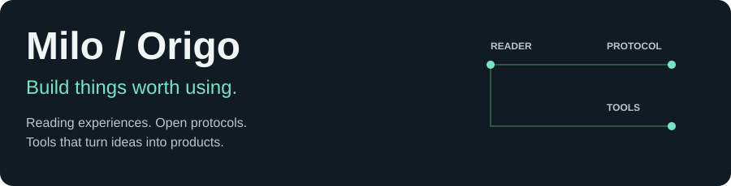
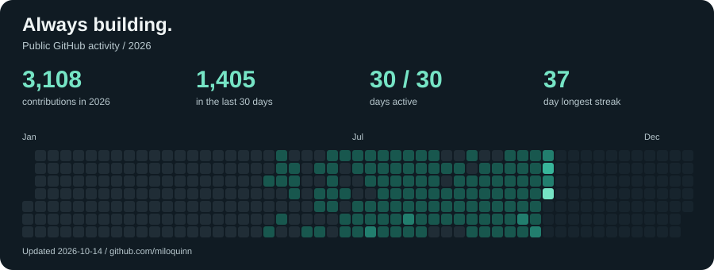

<picture>
  <source media="(max-width: 600px)" srcset="assets/hero-compact.svg">
  
</picture>

I'm Milo, also known as **Origo**. I build reading experiences, open protocols, and tools for developers.

From the details of a single page to the systems behind it, I turn ideas into products people can use.

**[Open Reading ↗](https://open.xxread.top)** · **[Explore my projects ↗](https://github.com/miloquinn?tab=repositories)** · **[Telegram ↗](https://t.me/kelonilk)**

## Featured Projects

### [Origo X · Open Reading](https://github.com/miloquinn/origo-x)

**A better reading experience, one page at a time.**

A cross-platform reader built with Flutter and Dart. The public source edition focuses on local reading: TXT / EPUB import, native pagination, page-turn modes, typography and themes, bookmarks, notes, text search, and system text-to-speech. Explore the full product through the website and official releases.

**[Visit website ↗](https://open.xxread.top)** · **[View source ↗](https://github.com/miloquinn/origo-x)** · **[Download ↗](https://github.com/miloquinn/origo-x/releases)**

### An ecosystem that connects

| Project | What it makes possible |
| :--- | :--- |
| **[Open Reading Source Protocol](https://github.com/miloquinn/origo-source-protocol)** | A shared HTTP contract for readers and independent content services, with a specification, JSON Schema, OpenAPI, and reference implementations. |
| **[ORSP Converter](https://github.com/miloquinn/orsp-converter)** | Turn book-source JSON rules into ORSP endpoints, with batch conversion, validation, and retries. |
| **[Niki AI](https://github.com/miloquinn/Niki-AI)** | Bring Claude Code into the Obsidian sidebar for AI-assisted writing and direct note editing. |
| **[Origo API](https://github.com/miloquinn/Origo-API)** | A self-hosted AI gateway built on New API, with unified model access, an admin console, billing displays, and developer-tool configuration. |

中文介绍 / Read in Chinese

我是 Milo，也叫 **Origo**。我把阅读器、开放协议和开发工具，做成可以真正使用的产品。

**开元阅读 · Origo X**：基于 Flutter / Dart 的跨平台阅读器。公开源码版专注于本地 TXT / EPUB 阅读，涵盖原生分页、排版、书签笔记、搜索和系统 TTS；完整产品可从官网和正式发行版体验。

**开放生态**：ORSP 提供统一的书源 HTTP 协议、规范和参考实现；ORSP Converter 把书源规则转换为协议端点，支持批量转换、验证和重试。

**AI 工具**：Niki AI 将 Claude Code 接入 Obsidian 笔记工作流；Origo API 基于 New API 提供自托管 AI 网关和管理控制台。

欢迎试用项目、提 Issue，或一起把一个好想法做出来。

## Always Building

<picture>
  <source media="(max-width: 600px)" srcset="assets/activity-compact.svg">
  
</picture>

Updated daily from GitHub's public contribution calendar. Contributions include commits, pull requests, and other activity counted by GitHub.

## Tech Stack

**Languages**

  
  
  
  
  
  
  
  
  
  
  
  
  
  
  

**Apps & Web**

  
  
  
  
  
  
  

**Backend & Data**

  
  
  
  
  
  
  

**Cloud & DevOps**

  
  
  
  
  
  
  
  
  
  
  

**AI, Hardware & Creative**

  
  
  
  

**Editors**

  
  
  

## Let's Build Something

I care about the experience, the protocol, and the engineering behind both. Try a project, open an issue, or reach out with an idea worth building.

**[GitHub ↗](https://github.com/miloquinn)** · **[Telegram ↗](https://t.me/kelonilk)**
